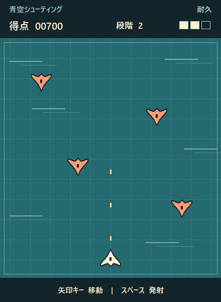

# 青空シューティング

## ゲームの概要

飛行機を操作して、上から来る敵機を撃ち落とす縦スクロール風のゲームです。制限時間はなく、耐久がなくなるまでに取った得点を競います。

## 動作環境

- Windows 11、Python 3.12 で動作確認済み。
- 画面の表示には Python 標準の `tkinter` を使います。外部ライブラリは使いません。

## インストール方法

Python 3 を用意し、このリポジトリをクローンするか、ZIP をダウンロードして展開してください。`pip install` は不要です。`python -m tkinter` で確認用のウィンドウが開けば、起動できます。

## 起動方法

`main.py` があるフォルダーで、次のコマンドを実行します。

```powershell
python main.py
```

## 操作方法

| キー | 操作 |
| --- | --- |
| Enter | ゲーム開始、または終了後にもう一度遊ぶ |
| 矢印キー | 自機を上下左右に移動 |
| スペース | 弾を発射。長押しで連射 |

敵機を1機倒すと100点です。敵機とぶつかると耐久が1減り、0になるとゲーム終了です。敵機を見逃しても耐久は減りません。

## 追加・改良した機能

1. **耐久と無敵時間**：基本版では1回の衝突で終了していました。改良版では3回まで衝突でき、被弾後は約1秒間だけ自機が点滅して次の衝突を防ぎます。`update()` で衝突と無敵時間を判定します。
2. **得点に応じた難易度**：500点ごとに難易度が上がり、敵機の速度が上がるとともに出現間隔が短くなります。難易度は5段階です。`stage()` が現在の段階を計算します。
3. **開始・再挑戦**：開始画面と結果画面を追加しました。終了後は Enter キーで得点・耐久・敵機などを初期化し、ウィンドウを閉じずに遊び直せます。`key_down()` と `reset()` で切り替えます。

## スクリーンショット



## 既知の問題・制限事項

- キーボード操作専用です。音声、ボス戦、最高得点の保存は実装していません。
- Windows 11 以外の環境では未確認です。

## クレジット

ベースはこの課題用に作成したオリジナルの基本版です。授業の配布ゲームや外部の画像素材は使用していません。機体や背景は `tkinter` の図形で描画しています。
